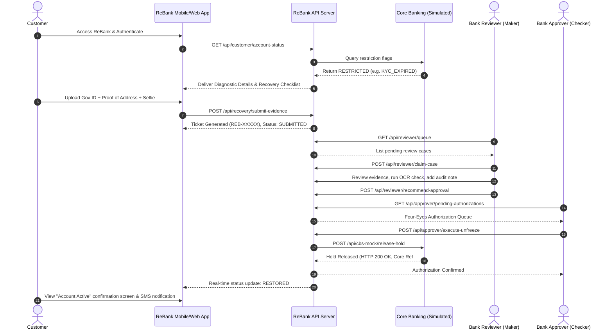

# ReBank — Bank Account Recovery Platform
## Comprehensive Product Requirements Document (PRD)

**Document Version:** 1.0.0  
**Status:** Approved for Prototype Implementation  
**Classification:** Confidential & Proprietary  
**Notice:** This platform is an educational, prototype demonstration. It simulates core banking interactions and **does not connect to or claim authorization/access to any real financial institution or real core banking system.**

---

## 1. System Vision & Problem Statement

### 1.1 The Problem
When retail or commercial bank accounts are frozen, restricted, or flagged by banking monitoring systems (due to regulatory KYC expiration, prolonged inactivity, anti-money laundering AML alerts, court garnishments, or suspicious login attempts), the customer experience breaks down:
- **Lack of Transparency:** Customers receive vague "Account Restricted" messages with no actionable guidance.
- **Branch Bottlenecks:** Customers are often forced to take time off work to visit physical bank branches with paper documents.
- **Manual Operations:** Bank back-office staff manually juggle physical folders, fragmented emails, and disparate legacy Core Banking System (CBS) screens.
- **Prolonged Turnaround Time (TAT):** Account unfreezing often takes 7 to 21 business days, harming customer trust and causing financial distress.

### 1.2 The ReBank Solution
**ReBank** is a modern, omni-channel (responsive mobile web and desktop operations portal) bank account recovery orchestration platform. It provides:
1. **Customer Self-Service Portal:** Step-by-step diagnostic breakdown of why the account was restricted, tailored recovery task checklists, digital identity verification (mock liveness selfie & ID capture), and real-time SLA tracking.
2. **Bank Operations Cockpit (Maker-Checker / Four-Eyes Principle):** Structured dual-control review workflow ensuring compliance with financial regulations before triggering unfreezing.
3. **Core Banking System (CBS) Adapter:** Simulated standard connectors to automatically release account holds once authorized.

---

## 2. User Roles & Permission Matrix

ReBank enforces strict Role-Based Access Control (RBAC) and segregation of duties.

| Role | Domain / Designation | Primary Responsibilities & Permitted Actions |
| :--- | :--- | :--- |
| **Customer** | Account Holder / Client | - Authenticate securely via mock mobile/web login.<br>- View account restriction diagnostics, freeze type, and required resolution checklist.<br>- Upload KYC credentials, proof of address, source of funds, and selfie liveness.<br>- Track ticket progress in real-time with granular timeline stages.<br>- Receive simulated SMS/Email notifications of resolution. |
| **Bank Reviewer (Maker / L1 Officer)** | L1 Operations / Fraud & Compliance Analyst | - Triage customer recovery submissions in the queue.<br>- Inspect submitted identity documents and compare against simulated core records.<br>- Review synthetic AI/OCR confidence scores and facial match scores.<br>- Add internal compliance audit notes.<br>- Transition tickets from `UNDER_REVIEW` to either `REVIEWED_PENDING_APPROVAL`, `REJECTED`, or `REQUESTED_MORE_INFO`. |
| **Bank Approver (Checker / L2 Manager)** | L2 Operations Manager / Branch Compliance Head | - Enforce the **Four-Eyes Principle** (Maker-Checker); cannot approve a case they reviewed as a Maker.<br>- Review verified findings, risk assessment, and maker recommendations.<br>- Provide final business authorization or rejection.<br>- Trigger automated Core Banking System (CBS) unfreeze API invocation.<br>- Override or escalate complex edge cases to legal/AML tier. |
| **System Administrator** | IT Operations / Platform Administrator | - Configure restriction categories, resolution policies, and required document rules.<br>- Monitor system-wide SLAs, queue health, and processing velocity.<br>- Inspect immutable audit trail logs for all state transitions.<br>- Manage synthetic CBS adapter latency, fault simulation modes, and test accounts. |

---

## 3. Supported Restriction Categories

ReBank categorizes account holds into six distinct banking restriction profiles, each with its own regulatory trigger, required remediation checklist, and risk tier:

```
+--------------------------------------------------------------------------------------------------+
|                                    RESTRICTION CATEGORIES                                        |
+------------------------------------+--------------------------+----------------------------------+
| Category Code                      | Severity / Risk Tier     | Resolution Pathway               |
+------------------------------------+--------------------------+----------------------------------+
| 1. DORMANT_INACTIVE                | Low                      | Identity Re-Verification + Txn   |
| 2. KYC_EXPIRED                     | Medium                   | Govt ID + Proof of Address OCR   |
| 3. AML_SUSPICIOUS_TXN              | High                     | Source of Funds + Invoice Docs   |
| 4. SECURITY_COMPROMISED            | High                     | Biometric Liveness + PW Reset    |
| 5. COURT_ATTACHMENT_LIEN           | Critical / Statutory     | Legal Dismissal / Settlement     |
| 6. OVERDRAFT_LIEN_HOLD             | Medium                   | Settlement of Overdue Balance    |
+------------------------------------+--------------------------+----------------------------------+
```

### Detailed Breakdown:

#### Category 1: Dormant / Inactive Account (`DORMANT_INACTIVE`)
- **Trigger:** Account has experienced no customer-initiated financial transactions for 365+ consecutive days (as mandated by banking regulations).
- **Impact:** Inbound deposits may be accepted, but all outbound debits, ATM withdrawals, and online wire transfers are blocked.
- **Required Customer Actions:**
  1. Confirm current primary contact information (phone, email, residential address).
  2. Complete selfie liveness check.
  3. Sign electronic reactivation consent declaration.
- **Workflow:** L1 Reviewer verifies identity match; L2 Approver authorizes automated core status change from `DORMANT` to `ACTIVE`.

#### Category 2: KYC Invalidation / Document Expiry (`KYC_EXPIRED`)
- **Trigger:** Government-issued National ID, Passport, or Proof of Address has expired past statutory periodic review periods (e.g., 2, 5, or 10-year AML cycles).
- **Impact:** Complete account freeze or debit-freeze pending refreshed customer due diligence (CDD).
- **Required Customer Actions:**
  1. Upload fresh photo of valid government-issued ID (Passport, Driving License, or National ID).
  2. Upload recent utility bill or bank statement (< 90 days old) as Proof of Address.
  3. Real-time OCR data extraction verification.
- **Workflow:** L1 Reviewer confirms document validity against synthetic core records; L2 Approver signs off update.

#### Category 3: AML / Suspicious Activity Alert Freeze (`AML_SUSPICIOUS_TXN`)
- **Trigger:** Internal transaction monitoring detected an anomaly (e.g., rapid velocity spikes, high-value transfers outside profile, or high-risk jurisdiction flags).
- **Impact:** Total debit and credit lock on specific accounts or customer profile.
- **Required Customer Actions:**
  1. Provide formal statement on the economic rationale for the flagged transaction(s).
  2. Upload supporting documentation (commercial contract, sales invoice, salary payslip, or inheritance deed).
  3. Source of wealth declaration.
- **Workflow:** Requires in-depth L1 review; high-risk flagged cases mandate senior L2 sign-off with recorded compliance rationale.

#### Category 4: Security / Credential Compromise Lock (`SECURITY_COMPROMISED`)
- **Trigger:** Multiple consecutive failed PIN/Password attempts, concurrent login from anomalous geographic regions, or flagged phishing indicator.
- **Impact:** Digital banking access locked; debit card temporarily suspended to prevent account takeover (ATO).
- **Required Customer Actions:**
  1. Multi-factor verification code via secondary channel.
  2. Biometric facial liveness verification matching registered baseline.
  3. Guided credential (password/PIN) rotation.
- **Workflow:** Automated or expedited L1 review; immediate unlock upon verified biometric match.

#### Category 5: Court / Regulatory Attachment & Statutory Tax Lien (`COURT_ATTACHMENT_LIEN`)
- **Trigger:** Formal receipt of judicial writ of attachment, child support enforcement, or revenue authority tax levy.
- **Impact:** Statutory debit freeze (often capped to the legal claim amount).
- **Required Customer Actions:**
  1. View official court reference number and executing authority details.
  2. Upload court satisfaction order, settlement deed, or tax clearance certificate.
- **Workflow:** Strict legal desk review; L2 Approver signs off only when legal document authenticity is certified.

#### Category 6: Negative Balance / Lien Overdraft Hold (`OVERDRAFT_LIEN_HOLD`)
- **Trigger:** Account balance fell below minimum threshold due to chargeback reversal, unpaid maintenance fees, or unarranged overdraft.
- **Impact:** Operational freeze preventing new debit transactions until settled.
- **Required Customer Actions:**
  1. Review outstanding balance breakdown.
  2. Link external payment source or acknowledge deposit settlement agreement.
- **Workflow:** Automated conditional release upon verified deposit credit or manual reviewer clearance.

---

## 4. End-to-End Customer & Operations Journeys

### 4.1 The Customer Recovery Journey



### 4.2 Detailed Journey Stages

1. **Detection & Diagnostic Phase:**
   - Customer logs in and is greeted not with a generic error code, but with a transparent **Status Dashboard**:
     - Current state: `FROZEN` / `DEBIT_BLOCKED`
     - Reason: Plain-language explanation with regulatory citation.
     - Impact: What can and cannot be done with the account.
     - Estimated Resolution Time: Standard SLA based on restriction category (e.g., 2–4 hours for KYC, 24 hours for AML).

2. **Digital Evidence Collection Phase:**
   - Step-by-step interactive wizard:
     - **Step 1:** Identity & Liveness Capture (selfie with simulated liveness challenge).
     - **Step 2:** Document Submission (drag-and-drop or device camera upload).
     - **Step 3:** Clarification Questionnaire (e.g., origin of funds, updated tax residency).
     - **Step 4:** Review & Digital Signature.

3. **Back-Office Triage & Maker Review Phase:**
   - Ticket enters the centralized `Bank Operations Queue`.
   - L1 Reviewer claims the ticket (preventing dual-handling collisions).
   - Reviewer UI displays side-by-side comparison:
     - Synthetic Core Banking Baseline Data vs. Newly Submitted Customer Documents.
     - Simulated Automated Verification scores (OCR Name Match: 98%, Face Match: 94%, Tamper Check: Clean).
   - Reviewer records required compliance notes and submits recommendation.

4. **Dual-Control Checker Authorization Phase:**
   - Case enters the `L2 Approval Queue`.
   - Segregation of duties is programmatically enforced: the user who completed L1 review cannot act as L2 approver for the same ticket.
   - Checker inspects case risk score, reviewer notes, and signs off with cryptographic or dual-key confirmation.

5. **Simulated Core Execution & Notification Phase:**
   - Backend calls the Core Banking System (CBS) Adapter: `releaseAccountHold(accountId, reasonCode, approverId)`.
   - Core Banking updates account status to `ACTIVE`.
   - Customer receives automated in-app and simulated SMS/Email notifications.
   - Case is archived with an immutable audit trail.

---

## 5. Edge Cases & Exception Handling

| Edge Case Scenario | Potential Impact | System Handling & Mitigation Strategy |
| :--- | :--- | :--- |
| **Biometric Liveness Failure** | Spoofed selfie or low-light failure | Threshold score < 80% triggers automatic fallback: customer is prompted to retry with better lighting or guided to schedule a simulated video-KYC session. |
| **Document Illegibility / Blur** | OCR parser cannot extract text | Real-time pre-flight validation alerts customer immediately during upload rather than days later in back-office review. |
| **PEP / Sanctions Watchlist Positive Hit** | Regulatory breach if unlocked | Automated simulated screening flag: Ticket is locked from normal L1/L2 flow and routed exclusively to the Senior Financial Crime Compliance (FCC) team. |
| **Incomplete or Contradictory Evidence** | Delay in verification | Reviewer can trigger `REQUEST_ADDITIONAL_INFO` with a specific deficiency reason; customer receives notification and a tailored re-upload slot. |
| **Concurrent Reviewer Collision** | Two officers reviewing the same case | Pessimistic locking mechanism: When Reviewer A opens a ticket, it is locked in `UNDER_REVIEW` with an active 15-minute lease timer. |
| **Core Banking System (CBS) Timeout** | Account marked approved in ReBank but still frozen in CBS | Outbox pattern with exponential backoff retry; if 3 retries fail, ticket enters `CBS_DESYNC_ALERT` for manual operations sync with CBS ref ID. |
| **Partial Hold Release** | Account has multiple concurrent restrictions (e.g., Tax Lien + KYC Expired) | System tracks discrete hold IDs. Resolving KYC clears the `KYC_HOLD`, but leaves `TAX_LIEN_HOLD` active until tax authority clearance is processed. |

---

## 6. Assumptions & Non-Functional Requirements

### 6.1 Assumptions
1. **Simulated Core Records:** For prototype demonstration, realistic synthetic accounts and seed scenarios are pre-loaded across all 6 restriction categories.
2. **Four-Eyes Enforcement:** The prototype allows fast role-switching (e.g. from Customer to Reviewer to Approver) for seamless demonstration, while strictly validating that the simulated Reviewer ID and Approver ID cannot be identical for any approved case.
3. **Responsive Design:** Customer recovery workflows must render flawlessly on simulated mobile screens (375px–430px viewport width) and standard desktop monitors.
4. **Data Isolation & Ephemeral State:** Prototype state can be reset to factory seed data at any time via an administrative reset button.

### 6.2 Non-Functional Requirements
- **Performance:** Sub-100ms API response time for all queue and case query operations.
- **Security & RBAC:** All REST endpoints validate incoming role headers/tokens before returning sensitive customer records.
- **Auditability:** Every state change records timestamp, actor ID, actor role, previous state, new state, and optional compliance rationale.
- **Modern UX:** Professional banking aesthetic with intuitive status pills, progress trackers, and document inspection viewports.

---

## 7. Demo Capabilities vs. Real Bank Integration

To guarantee compliance, transparency, and safety, the boundary between the prototype and a production banking deployment is explicitly documented below:

```
+----------------------------------------------------------------------------------------------------+
|                         DEMO CAPABILITIES vs. REAL BANK INTEGRATION                                 |
+------------------------------------+----------------------------------+----------------------------+
| Architectural Domain               | ReBank Prototype Demonstration   | Real Production Bank       |
+------------------------------------+----------------------------------+----------------------------+
| Core Banking System (CBS)          | High-fidelity Mock CBS Adapter   | Finacle / TCS BaNCS /      |
|                                    | with programmable latency & logs | Temenos Transact / Mambu   |
+------------------------------------+----------------------------------+----------------------------+
| Customer Identity Verification     | Simulated OCR extraction &       | Government Identity API    |
|                                    | synthetic selfie liveness checks | (Aadhaar / DigiLocker /    |
|                                    |                                  | DMV / SingPass / ID.me)    |
+------------------------------------+----------------------------------+----------------------------+
| AML / PEP Watchlist Screening      | Built-in synthetic watchlist     | LexisNexis Bridger Insight |
|                                    | rules and mock sanctions flags   | / ComplyAdvantage / Dow J. |
+------------------------------------+----------------------------------+----------------------------+
| Document Storage                   | Secure local filesystem /        | Encrypted AWS S3 / Azure   |
|                                    | data URI storage                 | Blob with WORM compliance  |
+------------------------------------+----------------------------------+----------------------------+
| Authentication & Authorization     | Role-based session switching     | OAuth 2.0 / OIDC / FAPI /  |
|                                    | with simulated 2FA OTP codes     | Hardware Security Modules  |
+------------------------------------+----------------------------------+----------------------------+
| Audit Trail Persistence            | Transactional JSON audit store   | Append-only distributed    |
|                                    | with tamper-evident log records  | ledger / Splunk / SIEM     |
+------------------------------------+----------------------------------+----------------------------+
```

> [!IMPORTANT]
> **Regulatory Disclaimer:**  
> ReBank is an independent technology prototype demonstration. It does **NOT** connect to, represent, or claim authorization or live API credentials for any real banking institution, central bank, or sovereign clearing house. All account numbers, balances, customer identities, and compliance flags are 100% synthetic.

---

## 8. Acceptance Criteria (BDD / Gherkin Style)

### Scenario 1: Customer Views Restricted Account Diagnostics
- **Given** an authenticated customer whose account is in `KYC_EXPIRED` restriction status
- **When** the customer opens the ReBank application
- **Then** the UI displays an amber alert banner indicating the exact freeze category, plain-language description, affected services (debits locked), and an interactive "Start Recovery" action button.

### Scenario 2: Customer Submits Recovery Evidence
- **Given** a customer on the recovery submission screen
- **When** the customer uploads a valid ID card, proof of address, and performs a selfie capture, then clicks "Submit Recovery Packet"
- **Then** a unique ticket ID (format: `REB-XXXXX`) is generated, ticket status becomes `SUBMITTED`, and estimated turnaround SLA is shown.

### Scenario 3: Bank Reviewer Inspects and Recommends
- **Given** an authenticated Bank Reviewer (Maker)
- **When** the reviewer claims a ticket from the queue, verifies the synthetic OCR match (> 90%), inputs compliance notes, and clicks "Recommend for Approval"
- **Then** the ticket transitions to `REVIEWED_PENDING_APPROVAL`, is removed from the Maker queue, and enters the Approver queue.

### Scenario 4: Bank Approver Enforces Four-Eyes Principle and Unfreezes CBS
- **Given** an authenticated Bank Approver (Checker) viewing a ticket in `REVIEWED_PENDING_APPROVAL`
- **When** the approver confirms all criteria and clicks "Authorize & Release CBS Hold"
- **Then** the system verifies that `approverId != reviewerId`, invokes the mock Core Banking System unfreeze endpoint, receives confirmation code `CBS-OK-200`, updates account status to `ACTIVE`, and notifies the customer.
